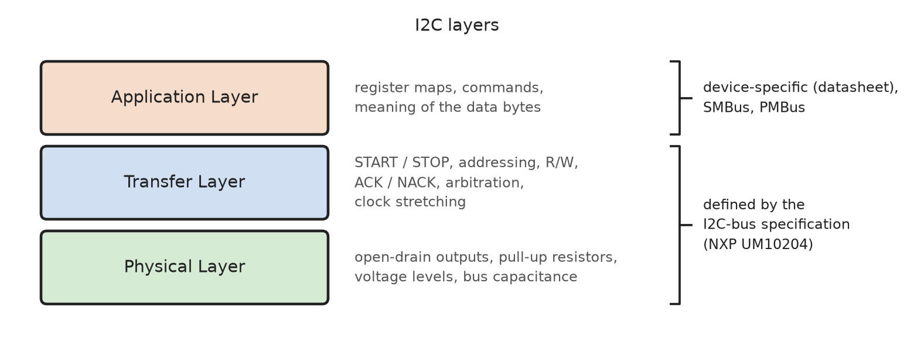
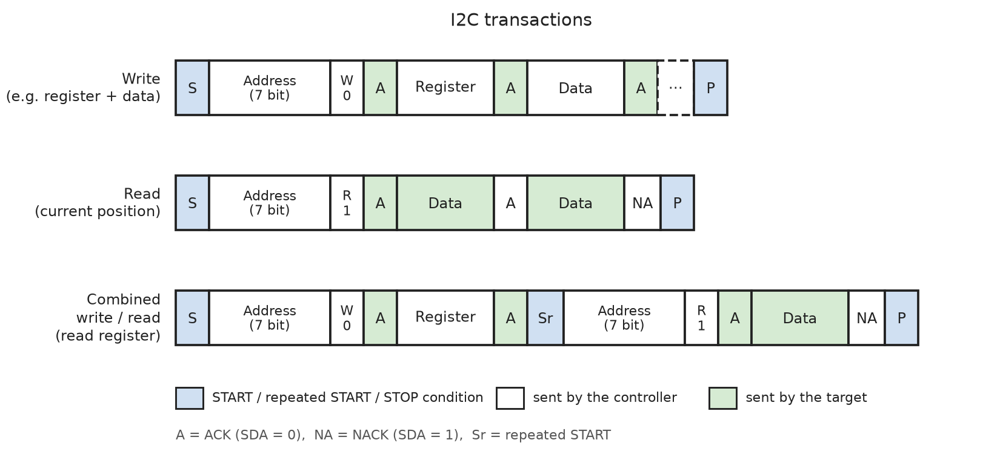
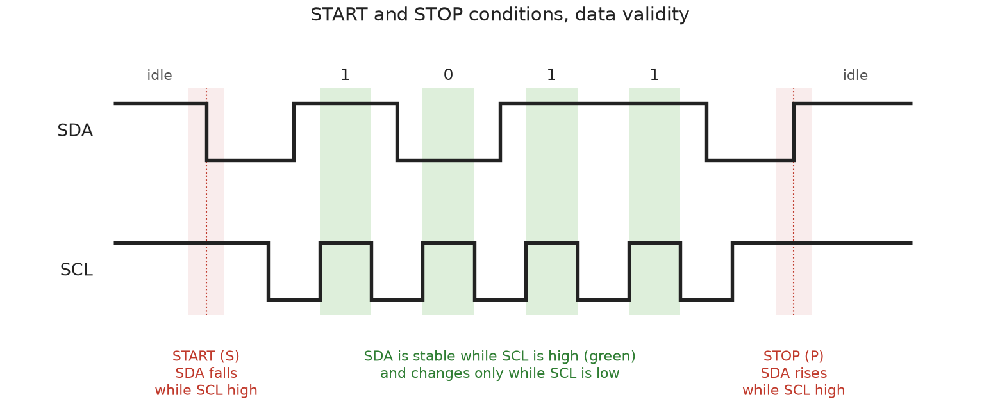
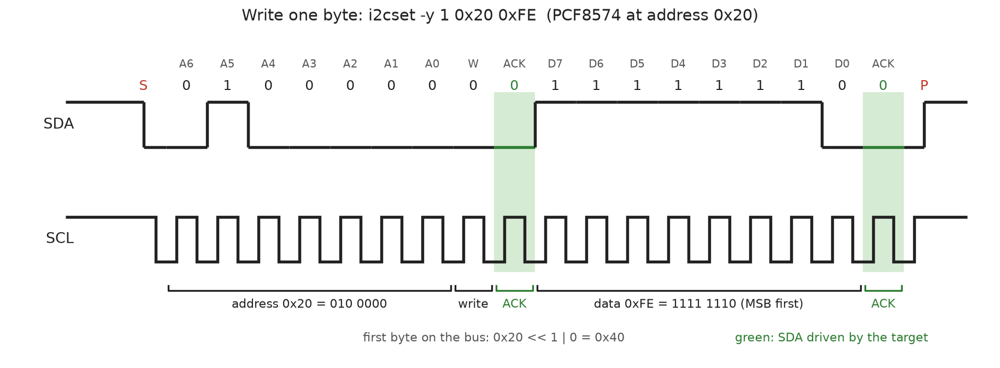
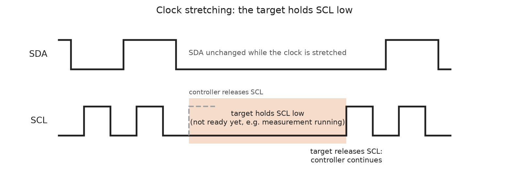
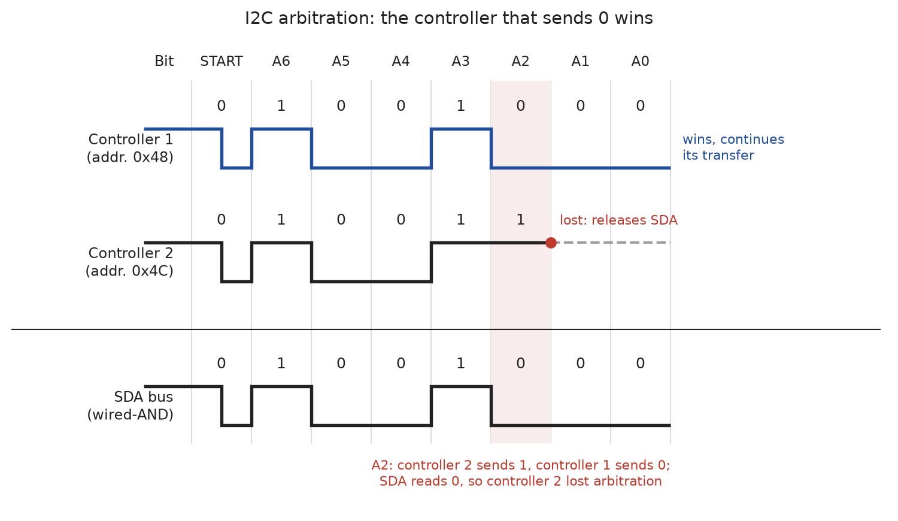
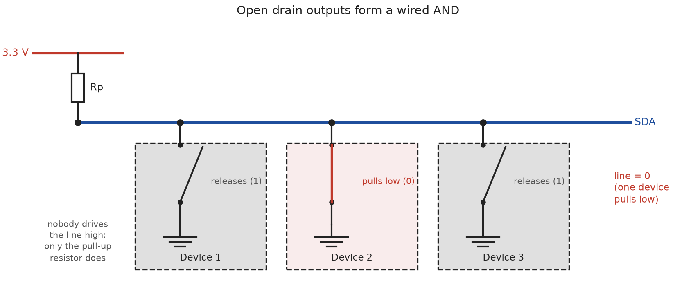
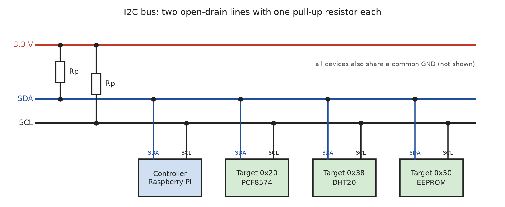
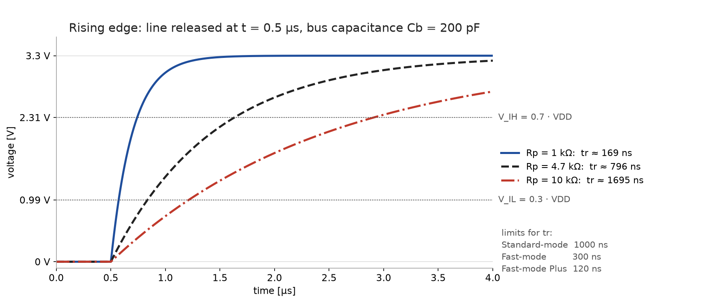

# I2C Protocol

The **Inter-Integrated Circuit (I2C, I²C)** bus was developed by **Philips
Semiconductors** (today **NXP**) in 1982 to connect integrated circuits on the
**same circuit board** with as few wires as possible. Instead of a parallel
bus with many address and data lines, all devices (microcontrollers, sensors,
EEPROMs, ADCs, port expanders, displays, ...) share **two signal lines**.
The current specification is the NXP document **UM10204 "I2C-bus
specification and user manual"**. Today I2C is used in almost every
electronic device, from mobile phones to PC mainboards (e.g. temperature
sensors, RAM module EEPROMs) and embedded systems.

> Since revision 7 (2021), the specification uses the terms **controller**
> and **target** instead of master and slave. Many datasheets and the Linux
> kernel still use the old terms.

Properties of the I2C bus:

* **Two wires**: **SDA** (Serial Data) and **SCL** (Serial Clock), plus a
  common GND.

* **Synchronous**: The controller generates the clock on SCL. Data on SDA is
  sampled while SCL is high, so no fixed bit rate has to be agreed on in
  advance (unlike CAN or UART).

* **Half-duplex**: Data travels in only one direction at a time, since there
  is only one data line.

* **Address-oriented**: Every target has a **unique 7-bit (or 10-bit)
  address**. The controller selects a target by sending its address at the
  start of each transfer. Only the addressed target answers.

* **Acknowledge after every byte**: The receiver confirms each byte with an
  **ACK** bit, so the transmitter knows whether the byte (and the target)
  was there.

* **Multi-controller**: Several controllers may share a bus. Collisions are
  resolved by **non-destructive bitwise arbitration** (like CAN).

* **Open-drain outputs** with **pull-up resistors**: A device can only pull a
  line low or release it. This makes arbitration, clock stretching and
  ACK possible without electrical conflicts.

Speed modes:

| Mode                       | Bit rate         | Notes                                        |
|----------------------------|------------------|----------------------------------------------|
| Standard-mode (Sm)         | up to 100 kbit/s | The original mode; default on the Raspberry Pi |
| Fast-mode (Fm)             | up to 400 kbit/s | Supported by most current devices            |
| Fast-mode Plus (Fm+)       | up to 1 Mbit/s   | Stronger drivers (20 mA)                     |
| High-speed mode (Hs)       | up to 3.4 Mbit/s | Special switching sequence, rarely used      |
| Ultra Fast-mode (UFm)      | up to 5 Mbit/s   | Write-only, push-pull, no ACK (e.g. LED drivers) |

The I2C protocol can be described in layers:



The I2C specification only defines how bytes are transferred. The **meaning
of the bytes** (which register, which command, which data format) is
defined in the **datasheet** of each device, or by higher-layer protocols
such as **SMBus** (System Management Bus, used on PC mainboards) and
**PMBus** (power supplies).


## Application Layer

From the application's point of view, an I2C **transfer** (message) consists
of:

* the **7-bit address** of the target,
* the **direction** (write: controller → target, read: target → controller),
* a number of **data bytes**.

Most I2C devices are organized as a set of **registers** (configuration,
status, measured values). A **register address** (also called command or
pointer byte) is sent as the first data byte of a write transfer. Its
meaning is device-specific and is described in the datasheet.

### Transactions



| Transaction            | Description                                                      |
|------------------------|------------------------------------------------------------------|
| **Write**              | The controller sends the address with W (0), followed by data bytes. With register-based devices, the first data byte selects the register, the following bytes are written to it (and often to the following registers, auto-increment). |
| **Read**               | The controller sends the address with R (1); the target sends data bytes. The controller acknowledges every byte except the **last one**, which it answers with **NACK** to tell the target to stop sending. |
| **Combined write/read**| The controller first writes the register address, then sends a **repeated START (Sr)** instead of a STOP and reads the data. Because the bus is never released between the two parts, no other controller can intervene. This is the typical way to **read a register**. |

Not all devices use registers. Simple devices such as the **PCF8574** port
expander have exactly one byte to write (the output pins) and one byte to
read (the input pins).

### Addresses

| Address (7 bit)     | Purpose                                                        |
|---------------------|----------------------------------------------------------------|
| `0x00`              | **General call** (addresses all devices) / START byte          |
| `0x01` - `0x07`     | Reserved (CBUS, other bus formats, Hs-mode controller code)    |
| `0x08` - `0x77`     | **Normal target addresses** (112 addresses)                    |
| `0x78` - `0x7B`     | Prefix for **10-bit addressing**                               |
| `0x7C` - `0x7F`     | Reserved (device ID)                                           |

The address of a device is defined by the manufacturer. To allow several
devices of the same type on one bus, the lower address bits can often be
selected with **address pins** (e.g. A0-A2 on the PCF8574: `0x20` -
`0x27`). Address conflicts between different devices are a common problem
on larger buses; an **I2C multiplexer** (e.g. TCA9548A) can split the bus
into separate segments.

> **7-bit vs. 8-bit addresses**: On the bus, the 7-bit address is shifted
> left by one and the R/W bit is appended. Some datasheets therefore give
> "8-bit addresses", e.g. `0x40` (write) and `0x41` (read) for a device with
> the 7-bit address `0x20`. Linux and the `i2c-tools` always use the
> **7-bit address**.

In **10-bit addressing**, the first byte contains the prefix `11110`, the
two most significant address bits and the R/W bit; the second byte contains
the remaining 8 address bits. 10-bit addressing is rarely used in practice.

### I2C Transfers in Linux

In Linux, the I2C buses are accessible from user space via the `i2c-dev`
driver as character devices `/dev/i2c-N`. A transfer is represented by
`struct i2c_msg` (`<linux/i2c.h>`):

```C
struct i2c_msg {
    __u16 addr;    /* 7-bit (or 10-bit) target address */
    __u16 flags;   /* I2C_M_RD (read), I2C_M_TEN (10-bit address), ... */
    __u16 len;     /* number of data bytes */
    __u8 *buf;     /* pointer to the data bytes */
};
```

Several messages can be passed to the kernel at once with the `I2C_RDWR`
`ioctl()` (`struct i2c_rdwr_ioctl_data` in `<linux/i2c-dev.h>`). They are
executed as **one combined transaction**: each message after the first one
begins with a **repeated START**, and only the last one ends with a STOP.

START, STOP, the address byte with the R/W bit, ACK/NACK and the clock are
generated by the **I2C controller hardware** (and its driver) and are not
visible to the application.

The `i2c-tools` provide the same operations on the command line:

```
$ i2cdetect -y 1                          # scan bus 1 for targets
$ i2cset -y 1 0x20 0xFE                   # write one byte 0xFE to 0x20
$ i2cget -y 1 0x20                        # read one byte from 0x20
$ i2cget -y 1 0x48 0x00 w                 # read a 16-bit word from register 0x00
$ i2ctransfer -y 1 w1@0x50 0x00 r8        # combined: write 0x00, Sr, read 8 bytes
```

In Python, the `smbus2` package offers the same functions
(`write_byte()`, `read_byte_data()`, ...) and raw messages via
`i2c_msg.write()` / `i2c_msg.read()` and `SMBus.i2c_rdwr()`.


## Transfer Layer

### Bus States: START and STOP

When no transfer is in progress, the bus is **idle**: both SDA and SCL are
released and pulled high by the pull-up resistors.



The basic rule is: **SDA may only change while SCL is low**. While SCL is
high, the data bit on SDA must be stable, because this is when the receiver
samples it.

Two exceptions to this rule mark the beginning and the end of a transfer:

| Condition               | Signal                                  | Meaning                               |
|-------------------------|-----------------------------------------|---------------------------------------|
| **START (S)**           | SDA falls (1 → 0) while SCL is high     | Start of a transfer; the bus is busy. |
| **STOP (P)**            | SDA rises (0 → 1) while SCL is high     | End of a transfer; the bus is free.   |
| **Repeated START (Sr)** | START without a preceding STOP          | Starts a new transfer (e.g. change of direction) without releasing the bus. |

START and STOP are always generated by the controller. Since they can never
occur inside a byte, every device on the bus can reliably detect where a
transfer begins.

### Byte Transfer and Acknowledge

Data is transferred in **bytes (8 bits)**, **most significant bit first**.
Each byte is followed by a **9th clock pulse** for the **acknowledge bit**,
which is sent by the **receiver**:

* **ACK** (0): The receiver pulls SDA low: "byte received, continue".
* **NACK** (1): The receiver leaves SDA high.

Example: Writing the byte `0xFE` to the PCF8574 at address `0x20` (all pins
high except P0, the same as `bus.write_byte(0x20, 0xFE)` in Python):



1. The controller generates a START.
2. It sends the 7-bit address `0x20` (`010 0000`) and the R/W bit `0`
   (write). On the bus this is the byte `0x40`.
3. The target recognizes its address and pulls SDA low during the 9th clock
   (ACK).
4. The controller sends the data byte `0xFE`, the target acknowledges again.
5. The controller generates a STOP.

A NACK can have different reasons:

* **No target** with this address exists (or it is not powered or not
  connected). This is how `i2cdetect` finds devices: it addresses every
  address and checks for an ACK.
* The target is **busy** and cannot accept data (e.g. an EEPROM during an
  internal write cycle).
* The target received an **invalid command** or data.
* The **controller** (as receiver) signals the **end of a read**: it
  answers the last byte with NACK.

In Linux, a missing ACK is reported to the application as an error, usually
`ENXIO` or `EREMOTEIO` depending on the driver (in Python:
`OSError: [Errno 121] Remote I/O error`).

### Clock Stretching

A target that needs more time (e.g. to finish a measurement or to prepare
the next byte) may **hold SCL low** after a byte. Since SCL is an open-drain
line, the controller cannot drive it high; it has to wait until the target
releases SCL. This is called **clock stretching**:



The controller must therefore read back SCL after releasing it and only
continue when SCL is really high.

> The I2C controller of the older Raspberry Pi SoCs (BCM2835 - BCM2711,
> i.e. Raspberry Pi 1 - 4) has a known **bug with clock stretching**: it
> only works in certain phases of the transfer. With devices that use
> clock stretching, this can lead to corrupted data. Workarounds are a lower
> clock rate or the software I2C driver (`dtoverlay=i2c-gpio`).

### Bitwise Arbitration

On a bus with **several controllers**, two of them may generate a START at
the same time. Like CAN, I2C resolves this collision **without losing data**:

* SDA is a **wired-AND**: a 0 (pulled low) always overwrites a 1 (released).
* Each controller **reads back** SDA after every bit it sends.
* A controller that sends a **1** but reads a **0** has **lost arbitration**.
  It immediately releases SDA and stops sending. If it is itself addressed,
  it switches to target mode.



* Up to bit A3, both controllers send the same bits, so neither of them
  notices the collision.
* At **A2**, controller 2 sends 1 but reads 0: it loses and releases the bus.
* **Controller 1** continues its transfer as if no collision had happened.
  The lower address wins.

If both controllers address the **same target**, arbitration continues
through the R/W bit and the data bytes. The losing controller retries after
the next STOP.

The SCL clocks of the controllers are synchronized in the same way:
because SCL is also a wired-AND, the low phase is determined by the
**slowest** controller (the one holding SCL low the longest).

### Error Detection

Compared to CAN, I2C has only **weak error detection**:

| Mechanism                  | Detects                                               |
|----------------------------|-------------------------------------------------------|
| **ACK / NACK**             | missing or busy target, rejected bytes                |
| **Arbitration**            | collisions with other controllers                     |
| **Timeouts** (SMBus only)  | targets that hold SCL low for too long (> 35 ms)      |

There is **no checksum** in the I2C protocol itself. Bit errors in the data
are not detected. Devices that need reliable data therefore add their own
check on the application layer, e.g. the **CRC-8** of the **DHT20** sensor,
or the optional **PEC** (Packet Error Code) of SMBus.

A typical failure is a **hanging bus**: if a controller is reset in the
middle of a read, the target may still hold SDA low (waiting for the next
clock). The controller can then no longer generate a START. The standard
**bus recovery** procedure is to generate up to **9 clock pulses** on SCL
until the target releases SDA, followed by a STOP. The Linux I2C core
implements this for drivers that support it.


## Physical Layer

### Open-Drain Outputs and Pull-Up Resistors

All devices are connected to SDA and SCL with **open-drain** (or
open-collector) outputs. Such an output has only two states:

* **Pull low** (output transistor on): the line is connected to GND → **0**.
* **Release** (output transistor off, high impedance) → the line is pulled
  high by the **pull-up resistor** → **1**.

No device ever drives a line actively high. Therefore, two devices can
never short-circuit each other, even if they send different bits at the
same time.



As on the CAN bus, the result is a **wired-AND**: the line is only high if
**all** devices release it.

| Device A     | Device B     | Line  |
|--------------|--------------|-------|
| 1 (release)  | 1 (release)  | 1     |
| 1 (release)  | 0 (pull low) | 0     |
| 0 (pull low) | 1 (release)  | 0     |
| 0 (pull low) | 0 (pull low) | 0     |


### Wiring and Topology

All devices are connected in parallel to the same SDA and SCL lines. Each
line needs exactly **one pull-up resistor (Rp)** to the supply voltage (not
one per device):



On the Raspberry Pi, I2C bus 1 (`/dev/i2c-1`) is available on the GPIO
header:

| Signal   | GPIO    | Header pin |
|----------|---------|------------|
| **SDA**  | GPIO 2  | Pin 3      |
| **SCL**  | GPIO 3  | Pin 5      |
| **3.3 V**| -       | Pin 1      |
| **GND**  | -       | Pin 6      |

The Raspberry Pi already has **1.8 kΩ pull-up resistors** to 3.3 V on
GPIO 2 and GPIO 3, so no external pull-ups are needed. Many breakout
boards also have their own pull-ups (typically 4.7 kΩ or 10 kΩ); with many
such boards on one bus, the parallel resistance can become too small (see
below).

I2C bus 0 (GPIO 0 / 1, pins 27 / 28) is reserved for the identification
EEPROM of HATs and should not be used for other devices.


### Signal Levels

I2C does not define fixed voltages. The levels depend on the supply voltage
**VDD** of the bus (on the Raspberry Pi: **3.3 V**):

| Level        | Condition                    | at VDD = 3.3 V |
|--------------|------------------------------|----------------|
| **Low** (0)  | V < V_IL = 0.3 · VDD          | < 0.99 V       |
| **High** (1) | V > V_IH = 0.7 · VDD          | > 2.31 V       |

All devices on a bus must use the **same voltage**, or a **level shifter**
must be used. The GPIO pins of the Raspberry Pi are **not 5 V tolerant**: a
5 V module whose pull-ups are connected to 5 V can damage the Pi. In this
case, use a bidirectional I2C level shifter (e.g. a BSS138 MOSFET module or
a PCA9306) or make sure the module's pull-ups are connected to 3.3 V.


### Pull-Up Resistors, Rise Time and Bus Capacitance

A falling edge is fast, because a transistor actively pulls the line low.
A **rising edge** is slow, because only the pull-up resistor charges the
**bus capacitance Cb** (cables, PCB traces, pin capacitances of all devices).
The line behaves like an RC circuit:



The **rise time** (from 0.3 · VDD to 0.7 · VDD) is:

```
tr = 0.8473 · Rp · Cb
```

The value of Rp is a compromise:

* **Rp too large**: The edges become too slow. At high clock rates the line
  does not reach V_IH before the bit is sampled. Maximum value:
  `Rp(max) = tr(max) / (0.8473 · Cb)`.

* **Rp too small**: When a device pulls the line low, the current
  `(VDD - V_OL) / Rp` becomes too large for its output transistor, and the
  low level is no longer below V_IL. Minimum value:
  `Rp(min) = (VDD - V_OL(max)) / I_OL`, e.g. (3.3 V - 0.4 V) / 3 mA ≈ 1 kΩ.

| Mode            | max. rise time tr | max. bus capacitance Cb | max. sink current I_OL |
|-----------------|-------------------|-------------------------|------------------------|
| Standard-mode   | 1000 ns           | 400 pF                  | 3 mA                   |
| Fast-mode       | 300 ns            | 400 pF                  | 3 mA                   |
| Fast-mode Plus  | 120 ns            | 550 pF                  | 20 mA                  |

Example: For Fast-mode with Cb = 100 pF:
`Rp(max) = 300 ns / (0.8473 · 100 pF) ≈ 3.5 kΩ`. The 1.8 kΩ pull-ups of the
Raspberry Pi are a good value for both Standard-mode and Fast-mode.


### Bit Rate and Bus Length

I2C was designed for connections **on a circuit board**. There is no fixed
maximum length; the limit is the **bus capacitance** (400 pF), which
increases with every centimeter of cable and every device. Typical cables
have 50 - 100 pF/m, so in practice I2C works reliably up to **about 1 m**
at 100 kHz (less at higher bit rates). For longer distances, special **bus
extenders** (e.g. P82B715, PCA9600) or a different bus (e.g. CAN or RS-485)
should be used.

Since the controller generates the clock, the bit rate is a property of the
controller only. All targets must support at least this rate. On the
Raspberry Pi, the default is **100 kHz**; it can be changed in
`/boot/firmware/config.txt`:

```
dtparam=i2c_arm=on
dtparam=i2c_arm_baudrate=400000
```


## References

* [YouTube (Rohde & Schwarz): Understanding I2C](https://youtu.be/CAvawEcxoPU?si=h-JJLRvsdmCv6wmC)

* NXP Semiconductors: [UM10204 I2C-bus specification and user manual](https://www.nxp.com/docs/en/user-guide/UM10204.pdf), Rev. 7.0, 2021

* Texas Instruments: [Understanding the I2C Bus (SLVA704)](https://www.ti.com/lit/an/slva704/slva704.pdf)

* Texas Instruments: [I2C Bus Pullup Resistor Calculation (SLVA689)](https://www.ti.com/lit/an/slva689/slva689.pdf)

* Linux Kernel Documentation: [Implementing I2C device drivers in userspace](https://docs.kernel.org/i2c/dev-interface.html)


*Egon Teiniker, 2025-2026, GPL v3.0*
