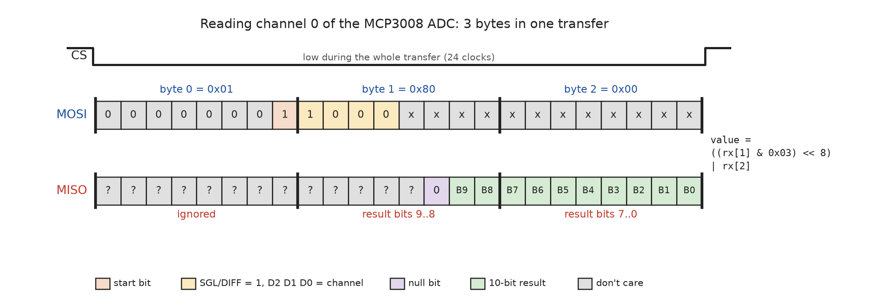

# Example: MCP3008 Analog-to-Digital Converter

The Raspberry Pi has no analog inputs. The **MCP3008** (Microchip) is a
popular way to add them: it is an **8-channel, 10-bit ADC** with an SPI
interface.

* 8 single-ended inputs (or 4 differential pairs)
* Resolution: 10 bit (0 - 1023)
* Supply voltage: 2.7 to 5.5 V (use **3.3 V** on the Raspberry Pi)
* Maximum clock rate: 1.35 MHz at 2.7 V, 3.6 MHz at 5 V
* SPI modes 0 and 3


## Wiring

| MCP3008 pin    | Function                | Raspberry Pi            |
|----------------|-------------------------|-------------------------|
| 16 VDD         | Supply                  | 3.3 V (pin 1)           |
| 15 VREF        | Reference voltage       | 3.3 V (pin 1)           |
| 14 AGND        | Analog ground           | GND (pin 6)             |
| 13 CLK         | Clock                   | SCLK, GPIO 11 (pin 23)  |
| 12 DOUT        | Data out                | MISO, GPIO 9 (pin 21)   |
| 11 DIN         | Data in                 | MOSI, GPIO 10 (pin 19)  |
| 10 CS/SHDN     | Chip select             | CE0, GPIO 8 (pin 24)    |
| 9 DGND         | Digital ground          | GND                     |
| 1 - 8 CH0 - CH7 | Analog inputs          | e.g. potentiometer wiper |

For a first test, connect a **potentiometer** (e.g. 10 kΩ) between 3.3 V and
GND and its wiper to **CH0**.

> The input voltage must stay between AGND and VREF (0 - 3.3 V).


## Protocol

The MCP3008 has **no registers**. Each conversion is one SPI transfer of
**3 bytes** (CS stays low for all 24 clocks):



| Byte | Sent (MOSI)                          | Received (MISO)                |
|------|--------------------------------------|--------------------------------|
| 0    | `0x01`: start bit                    | ignored                        |
| 1    | `(0x08 \| channel) << 4`: SGL/DIFF = 1, D2 D1 D0 = channel | bits 1..0 = result bits 9..8 |
| 2    | `0x00`: dummy                        | result bits 7..0               |

The ADC samples the input after the channel bits, outputs a null bit and
then the 10 result bits, MSB first. The start bit is placed at the end of
byte 0, so that the result is aligned to the end of byte 2:

```
value   = ((rx[1] & 0x03) << 8) | rx[2]
voltage = value * VREF / 1024
```

The class uses `xfer2()`, which keeps CS low for all three bytes. If CS went
high between the bytes, the MCP3008 would abort the conversion.


## Usage

The `MCP3008` class (`mcp3008.py`) takes an opened `SpiDev` object and sets
the clock rate and SPI mode. `main.py` uses the class like this:

```python
import spidev
from mcp3008 import MCP3008

spi = spidev.SpiDev()
spi.open(0, 0)
adc = MCP3008(spi, vref=3.3)
raw = adc.read_raw(0)
voltage = adc.read_voltage(0)
```


## Run

```bash
$ python3 main.py
Connected to MCP3008 at /dev/spidev0.0
CH0: raw =  543 | voltage = 1.750 V
CH0: raw =  544 | voltage = 1.753 V
...
```

Turn the potentiometer: the value changes between 0 and 1023.

The same transfer can be tested from the command line (see
[SPI Tools](../../../spi-tools/README.md)):

```bash
$ printf '\x01\x80\x00' | spi-pipe -d /dev/spidev0.0 -s 1000000 -b 3 -n 1 | hexdump -C
```


## References

* Microchip: MCP3004/3008 Datasheet
* [spidev](https://pypi.org/project/spidev/)

*Egon Teiniker, 2025-2026, GPL v3.0*
