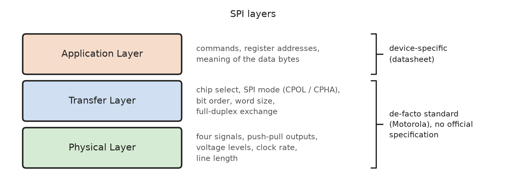
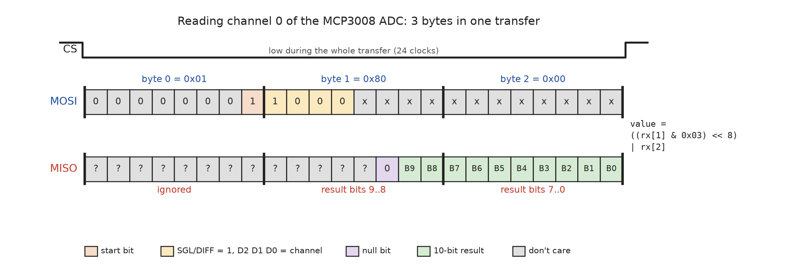
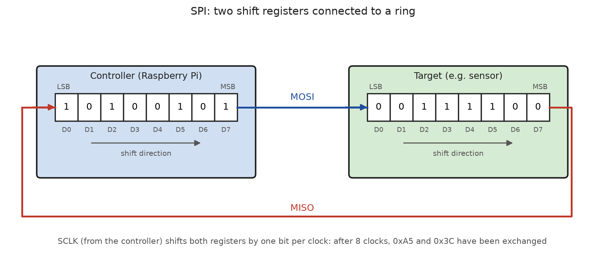
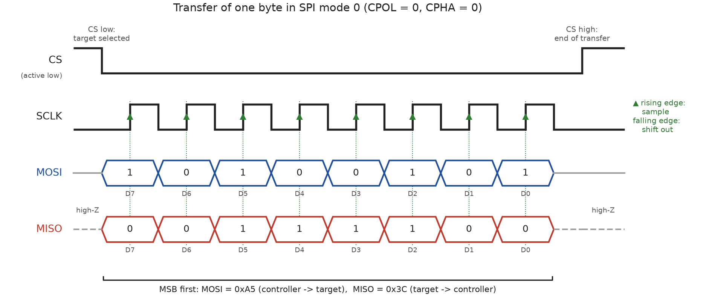
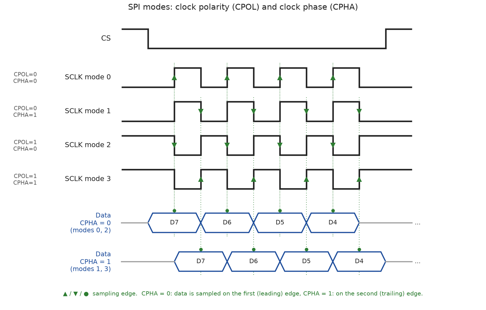
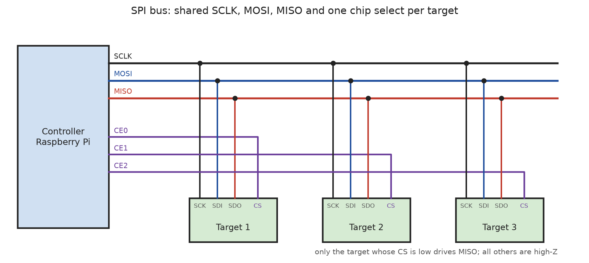
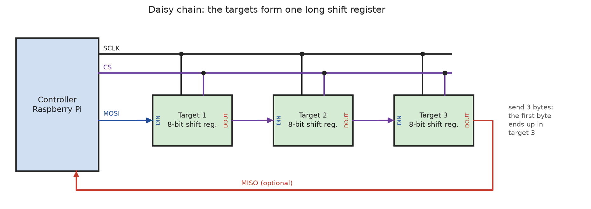

# SPI Protocol

The **Serial Peripheral Interface (SPI)** was introduced by **Motorola** in
the 1980s to connect peripheral chips (EEPROMs, ADCs, DACs, displays, ...)
to its microcontrollers. Since then, it has become one of the most widely used
on-board interfaces. Typical SPI devices are flash memories, SD cards, ADCs
and DACs, displays, touch controllers, sensors, radio modules and CAN
controllers (e.g. the **MCP2515**).

SPI has **no official specification**. It is a
**de-facto standard**: the basic principle is always the same, but the
details (clock mode, word size, chip select behavior, commands) are defined
in the **datasheet** of each device.

> The signal names **MOSI** (Master Out Slave In) and **MISO** (Master In
> Slave Out) are still used by the Raspberry Pi documentation and most
> datasheets. Newer documents use **SDO / SDI** (Serial Data Out / In, seen
> from the device) or **COPI / CIPO** (Controller Out Peripheral In, ...).
> This document uses controller and target, together with the classic signal
> names.

Properties of the SPI bus:

* **Four signals**: **SCLK** (clock), **MOSI** (data controller → target),
  **MISO** (data target → controller) and **CS** (Chip Select, also called
  SS or CE), plus a common GND.

* **Synchronous**: The controller generates the clock. No bit rate has to
  be agreed on in advance, the targets simply follow SCLK.

* **Full-duplex**: Data is sent and received **at the same time**, one bit
  in each direction per clock cycle.

* **Single controller**: Only one controller drives the clock and selects
  the targets. There is no arbitration.

* **No addresses**: Each target has its own **chip select** line. A target
  only takes part in a transfer while its CS is active (usually low).

* **No protocol overhead**: There are no START/STOP conditions, no
  acknowledge, no flow control and no error detection. A transfer is simply
  a stream of bits of any length.

* **Push-pull outputs**: Signals are actively driven high and low, so SPI
  reaches high clock rates (typically 1 - 50 MHz, flash memories up to
  over 100 MHz).

The SPI protocol can be described in layers:



Since SPI only defines how bits are exchanged, everything else (the meaning
of the first byte, register addresses, read/write flags, data formats) is
**device-specific** and described in the datasheet.


## Application Layer

From the application's point of view, an SPI **transfer** consists of:

* the **target** (selected by its chip select),
* a **transmit buffer** (bytes sent on MOSI),
* a **receive buffer** of the **same length** (bytes received on MISO).

Because SPI is full-duplex, every transfer is an **exchange**: for each byte
the controller sends, it receives one byte at the same time. If only one
direction is needed, the other one carries dummy bytes:

* **Write**: The controller sends a command and data; the received bytes
  are ignored.
* **Read**: The controller sends a command, followed by dummy bytes
  (usually `0x00` or `0xFF`) to generate the clock for the answer.

### Typical Command Formats

Most SPI devices expect a **command or register address** in the first byte
of a transfer, followed by data. How a read is distinguished from a write
depends on the device, common examples:

| Device type                    | First byte(s)                                            |
|--------------------------------|----------------------------------------------------------|
| Register-based sensors         | Register address, **bit 7 = 1 for read**, 0 for write (e.g. many accelerometers) |
| Flash memories (e.g. W25Qxx)   | Command code (`0x03` read, `0x02` page program, `0x9F` read ID), followed by a 24-bit address |
| ADCs (e.g. MCP3008)            | Start bit and channel selection                          |
| Shift registers (e.g. 74HC595) | No command, every byte is output data                    |

Example: Reading channel 0 of the **MCP3008** 10-bit ADC. The controller
sends 3 bytes and receives 3 bytes in the same transfer. The result arrives
while the controller is still sending (dummy) bits:



### Chip Select Frames the Transfer

The chip select line is the only "framing" information SPI has:

* **CS goes active (low)**: start of a transfer; the target resets its
  internal bit counter and expects a new command.
* **CS goes inactive (high)**: end of a transfer; many devices only
  **execute a command** or **latch the data** at this moment (e.g. the
  74HC595 copies its shift register to its outputs).

Therefore, it matters whether a command and its data are sent in **one
transfer** (CS low the whole time) or in two separate transfers.

### SPI Transfers in Linux

In Linux, the `spidev` driver makes each chip select of an SPI bus
available to user space as a character device `/dev/spidevB.C` (B = bus,
C = chip select), e.g. `/dev/spidev0.0`. A transfer is described by
`struct spi_ioc_transfer` (`<linux/spi/spidev.h>`):

```C
struct spi_ioc_transfer {
    __u64 tx_buf;          /* pointer to the transmit buffer (or 0) */
    __u64 rx_buf;          /* pointer to the receive buffer (or 0) */
    __u32 len;             /* number of bytes */
    __u32 speed_hz;        /* clock rate for this transfer */
    __u16 delay_usecs;     /* delay after this transfer */
    __u8  bits_per_word;   /* word size (usually 8) */
    __u8  cs_change;       /* release CS after this transfer */
    __u8  tx_nbits;
    __u8  rx_nbits;
    __u8  word_delay_usecs;
    __u8  pad;
};
```

Several transfers can be executed as one **message** with
`ioctl(fd, SPI_IOC_MESSAGE(n), transfers)`. CS stays active for the whole
message unless `cs_change` is set. The SPI mode, word size and maximum clock
rate are set with `SPI_IOC_WR_MODE`, `SPI_IOC_WR_BITS_PER_WORD` and
`SPI_IOC_WR_MAX_SPEED_HZ`.

Many SPI devices also have a **kernel driver** (e.g. the MCP2515 CAN
controller, displays, ADCs via the IIO subsystem). They are enabled with a
device tree overlay, and the corresponding `spidev` device disappears.

For command-line tools see [SPI Tools](../spi-tools/README.md), for Python
see [spidev](../python/spidev/introduction/README.md).


## Transfer Layer

### Two Shift Registers

The principle of SPI is simple: the controller and the target each contain
a **shift register**, and MOSI and MISO connect the two registers to a
**ring**:



With every clock cycle, both registers shift by one bit: one bit moves from
the controller to the target on MOSI and, at the same time, one bit moves
from the target to the controller on MISO. After 8 clock cycles, the two
registers have **exchanged their contents**.

### Transfer of a Byte



1. The controller pulls **CS low** to select the target. The target starts
   driving MISO (before, MISO was high-impedance).
2. The controller generates **8 clock pulses** on SCLK. Data is usually
   transferred **MSB first**.
3. On one clock edge, both sides **output** the next bit; on the other edge,
   both sides **sample** (read) the bit.
4. After the last byte, the controller pulls **CS high**. The target
   releases MISO.

There is no acknowledge: the controller **cannot detect** whether a target
is present at all. Without a target, MISO usually reads constant `0x00` or
`0xFF` (depending on pull-up/pull-down resistors).

### SPI Modes (CPOL and CPHA)

Different devices use different clock edges. Two parameters define the
timing, which results in four **SPI modes**:

* **CPOL** (Clock Polarity): the idle level of SCLK (0 = low, 1 = high).
* **CPHA** (Clock Phase): the edge on which data is sampled
  (0 = first/leading edge, 1 = second/trailing edge).



| Mode | CPOL | CPHA | SCLK idle | Data sampled on   | Data changed on   |
|------|------|------|-----------|-------------------|-------------------|
| 0    | 0    | 0    | low       | rising edge       | falling edge      |
| 1    | 0    | 1    | low       | falling edge      | rising edge       |
| 2    | 1    | 0    | high      | falling edge      | rising edge       |
| 3    | 1    | 1    | high      | rising edge       | falling edge      |

**Mode 0** is by far the most common and the default in Linux. Many devices
support both mode 0 and mode 3 (e.g. the MCP3008). The required mode is
listed in the datasheet, often only as a timing diagram. A wrong mode
typically results in data that is **shifted by one bit** or completely
wrong.

### Bit Order and Word Size

* **Bit order**: Almost all devices transfer the **MSB first**. Some (rare)
  devices expect LSB first (`SPI_LSB_FIRST` in Linux).
* **Word size**: Usually **8 bits**. Some controllers support other word
  sizes (e.g. 9 or 16 bits), but most devices with longer data words simply
  use several bytes.

### Several Targets

Since there are no addresses, there are two ways to connect several targets:

**Independent chip selects** (the usual way): SCLK, MOSI and MISO are shared,
and every target gets its own CS line. Only the selected target drives MISO,
all others keep their MISO output in high-impedance state.



The number of targets is limited by the number of available chip select
pins. Additional GPIOs can be used as chip selects.

**Daisy chain**: All targets share SCLK and CS, and the data output of each
target is connected to the data input of the next one. The targets form one
long shift register, so the controller sends one byte per target in a
single transfer. This is typical for shift registers (74HC595), LED drivers
and some DACs.



### Variants

| Variant          | Description                                                         |
|------------------|---------------------------------------------------------------------|
| **3-wire SPI**   | One bidirectional data line (SDIO) instead of MOSI and MISO; half-duplex. |
| **Dual SPI**     | Two data lines used in the same direction (2 bits per clock).        |
| **Quad SPI (QSPI)** | Four data lines (4 bits per clock), mainly for flash memories.    |

### Error Detection

SPI itself has **no error detection** at all: no acknowledge, no parity,
no checksum. Errors (wrong SPI mode, too high clock rate, missing device,
noise) are only visible as wrong data. Devices that need reliable data add
their own mechanisms on the application layer, e.g. CRC bytes (SD cards in
SPI mode), status registers or a readable **device ID** register (a good
first test for a new device: read the ID and compare it with the
datasheet).


## Physical Layer

### Push-Pull Outputs

SPI outputs are **push-pull** outputs: they actively drive the line high or
low. Therefore, no pull-up resistors are needed, and edges are fast
(no RC rise time as with open-drain buses). This is why SPI reaches high
clock rates.

As a consequence, **two outputs must never drive the same line at the same
time**. On the shared MISO line, this is ensured by the chip selects: a
target that is not selected must switch its MISO output to **high-impedance
(high-Z)**. Some devices do not release MISO correctly and cannot share the
bus with other devices.

A pull-up resistor (e.g. 10 kΩ) on each **CS line** is recommended, so that
all targets stay deselected while the controller is booting and its pins
are not configured yet.

### Wiring on the Raspberry Pi

The Raspberry Pi has an SPI controller **SPI0** on the GPIO header with two
chip selects:

| Signal         | GPIO    | Header pin | Linux device      |
|----------------|---------|------------|-------------------|
| **MOSI**       | GPIO 10 | Pin 19     |                   |
| **MISO**       | GPIO 9  | Pin 21     |                   |
| **SCLK**       | GPIO 11 | Pin 23     |                   |
| **CE0** (CS 0) | GPIO 8  | Pin 24     | `/dev/spidev0.0`  |
| **CE1** (CS 1) | GPIO 7  | Pin 26     | `/dev/spidev0.1`  |

A second controller **SPI1** with up to three chip selects (GPIO 16 - 21)
can be enabled with a device tree overlay, see
[Setup SPI](../setup/README.md).

### Signal Levels

SPI does not define voltages. All devices on the bus must use the **same
logic levels** as the controller. The GPIO pins of the Raspberry Pi use
**3.3 V** and are **not 5 V tolerant**: a 5 V device must be supplied with
3.3 V (if allowed by its datasheet), or a **level shifter** must be used
(at least on MISO, the only line driven by the target). Since SPI uses
push-pull outputs, unidirectional level shifters (e.g. 74LVC245, 74HCT125)
can be used, which are faster than bidirectional MOSFET level shifters.

### Clock Rate and Line Length

The maximum clock rate is defined by the **slowest device** on the bus and
by the **wiring**:

* **Device limit**: The datasheet specifies the maximum SCLK frequency,
  often depending on the supply voltage (e.g. MCP3008: 3.6 MHz at 5 V,
  1.35 MHz at 2.7 V).

* **Round-trip delay**: The controller samples MISO on a clock edge that it
  generated itself. The bit from the target has to travel back through the
  wires and the target's output delay, and must arrive before the
  controller samples it. Long wires therefore limit the clock rate.

* **Signal integrity**: The fast edges of push-pull outputs cause
  **ringing** and **crosstalk** on long wires. A clock edge that rings
  can be counted twice by the target, which shifts all following bits.
  A small series resistor (22 - 47 Ω) at the driver output and a GND wire
  next to SCLK help.

SPI was designed for connections **on a circuit board**. With jumper wires
on a breadboard (10 - 20 cm), clock rates of a few MHz usually work
reliably. If a device shows random errors, the first thing to try is a
**lower clock rate**.

The clock rate is set per transfer by the application (`max_speed_hz` in
`spidev`). The SPI controller derives SCLK from its own clock with a
divider, so the requested value is **rounded down** to the next possible
frequency.


## References

* [Linux Kernel Documentation: Overview of Linux kernel SPI support](https://docs.kernel.org/spi/spi-summary.html)

* [Linux Kernel Documentation: SPI userspace API (spidev)](https://docs.kernel.org/spi/spidev.html)

* [Raspberry Pi Documentation: Serial Peripheral Interface (SPI)](https://www.raspberrypi.com/documentation/computers/raspberry-pi.html#serial-peripheral-interface-spi)

* Analog Devices: [Introduction to SPI Interface](https://www.analog.com/en/resources/analog-dialogue/articles/introduction-to-spi-interface.html)

* Microchip: MCP3004/3008 2.7V 4-Channel/8-Channel 10-Bit A/D Converters with SPI Serial Interface (Datasheet)


*Egon Teiniker, 2025-2026, GPL v3.0*
