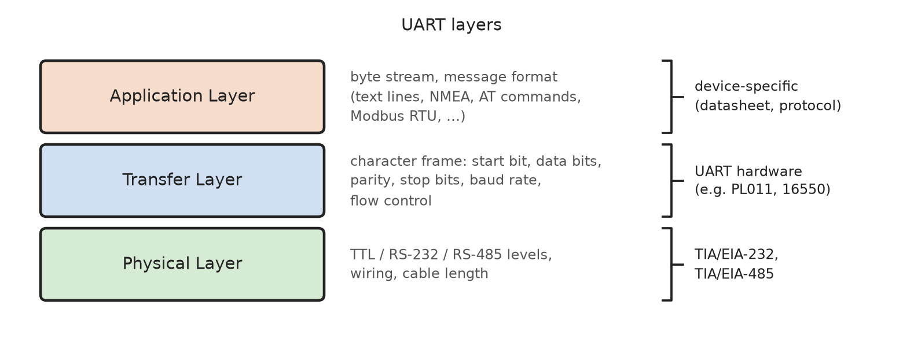
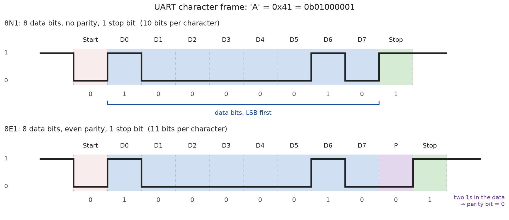
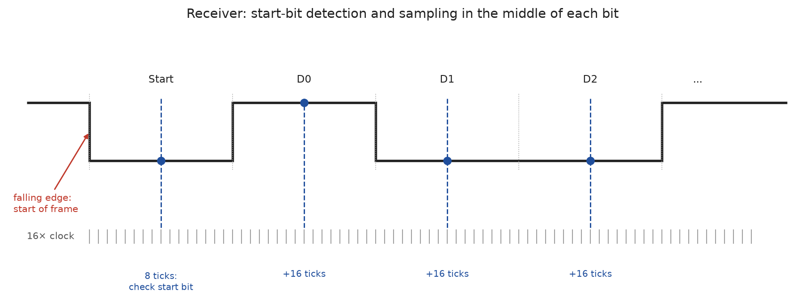
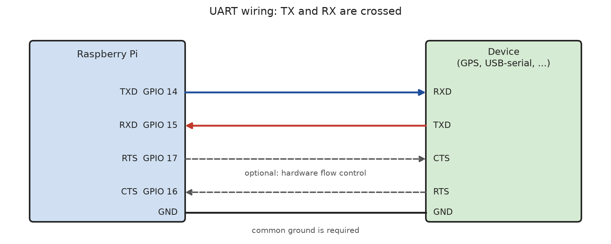
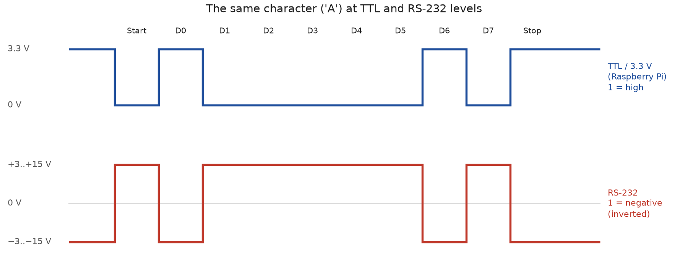
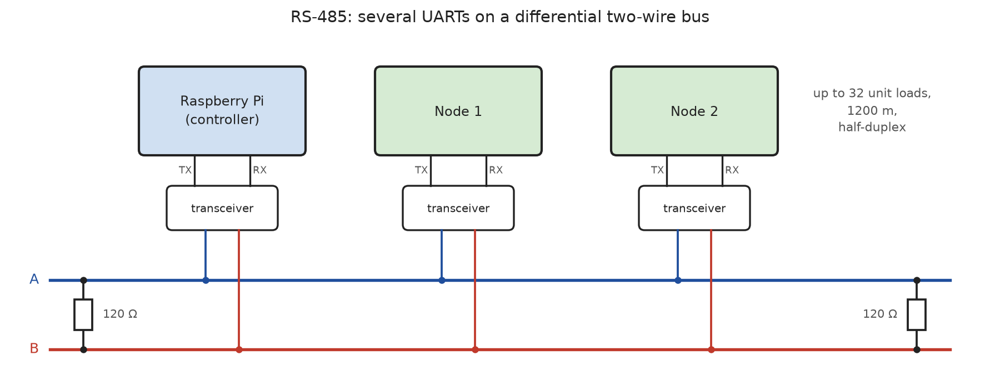

# UART Protocol

A **UART (Universal Asynchronous Receiver Transmitter)** is a hardware unit
that converts bytes into a serial bit stream and back. It is the oldest and
simplest serial interface: it was used to connect teleprinters and modems
(RS-232, 1960s), and the classic PC **COM ports** were UARTs (the National
Semiconductor **16550** became the de-facto standard UART chip). Today
almost every microcontroller and SoC contains one or more UARTs. Typical
UART devices are GPS receivers, GSM/LTE and Bluetooth modules, fingerprint
sensors, RFID readers, USB-serial adapters and the **serial console** of
embedded Linux systems.

Strictly speaking, UART is the name of the hardware, not of a protocol.
The **character frame** it sends is not defined by a single specification,
but it is the same everywhere. The **electrical levels** are defined by
standards such as **TIA/EIA-232** (RS-232) and **TIA/EIA-485** (RS-485), or
are simply the logic levels of the chip (**TTL** level, 3.3 V on the
Raspberry Pi).

Properties of a UART connection:

* **Two data lines**: **TX** (transmit) and **RX** (receive), plus a common
  GND. Optionally **RTS** and **CTS** for hardware flow control.

* **Asynchronous**: There is **no clock line**. Both sides must agree on the
  **baud rate** in advance. Each character starts with a **start bit**, on
  which the receiver synchronizes.

* **Full-duplex**: Each direction has its own line, so both sides can send
  at the same time.

* **Point-to-point**: A UART connection links exactly **two devices**. There
  are no addresses (RS-485 extends this to a bus, see below).

* **Character-oriented**: The unit of transfer is a **character** of 5 - 9
  data bits (almost always 8). There is no concept of a message or packet:
  the application sees a **stream of bytes**.

* **Simple error detection**: An optional **parity bit** per character, and
  the detection of **framing errors**. There is no acknowledge and no
  retransmission.

Typical baud rates:

| Baud rate     | Typical use                                                   |
|---------------|---------------------------------------------------------------|
| 9600          | Default of many GPS receivers, sensors and modules            |
| 19200 - 57600 | Modbus RTU, older devices                                     |
| 115200        | Serial console of the Raspberry Pi and most embedded boards   |
| 1 - 4 Mbit/s  | Bluetooth modules, fast data transfer (needs short wires)     |

The UART protocol can be described in layers:




## Application Layer

From the application's point of view, a UART connection is a **byte
stream** in both directions, like a pipe or a TCP connection. The UART
does not tell the receiver where a message begins or ends. This
**framing** of messages must be defined by the application protocol.
Common ways are:

| Framing                | Description                                                | Examples                        |
|------------------------|------------------------------------------------------------|---------------------------------|
| **Text lines**         | ASCII text, each message ends with `\n` or `\r\n`          | NMEA 0183 (GPS), AT commands, serial console |
| **Start/end marker**   | Special byte at the start and/or end, often with escaping  | SLIP, HDLC (PPP), many sensor protocols |
| **Length field**       | Header with a fixed start byte and the length of the data  | u-blox UBX, fingerprint sensors  |
| **Pauses**             | A gap of at least 3.5 characters ends a message            | Modbus RTU                      |

Most protocols also add a **checksum** to each message (e.g. XOR in NMEA,
CRC-16 in Modbus RTU), because the parity bit of the UART only detects
single bit errors per character.

_Example:_ A GPS receiver sends **NMEA 0183** sentences at 9600 baud, one
text line per sentence:

```
$GPGGA,123519,4807.038,N,01131.000,E,1,08,0.9,545.4,M,46.9,M,,*47\r\n
```

* `$` marks the start, `\r\n` the end of the sentence.
* `GPGGA` is the sentence type (GP = GPS, GGA = position fix data).
* The fields are separated by commas.
* `*47` is the checksum: the XOR of all characters between `$` and `*`, as
  two hexadecimal digits.

### Serial Ports in Linux

In Linux, UARTs are handled by the **TTY subsystem** (from teletype) and
appear as character devices:

| Device             | Description                                                     |
|--------------------|-----------------------------------------------------------------|
| `/dev/ttyAMA0`     | ARM **PL011** UART (Raspberry Pi)                               |
| `/dev/ttyS0`       | 16550-compatible UART (PC COM1), **mini UART** on the Raspberry Pi |
| `/dev/serial0`     | Raspberry Pi: symbolic link to the UART on GPIO 14/15           |
| `/dev/ttyUSB0`     | USB-serial adapter (FTDI, CP210x, CH340, ...)                   |
| `/dev/ttyACM0`     | USB CDC ACM device (Arduino, Raspberry Pi Pico, modems, ...)    |

The device is opened and used with the normal file system calls `open()`,
`read()`, `write()` and `close()`. Between the driver and the application,
the kernel's **line discipline** processes the data. By default it works
in **canonical mode** for interactive terminals: input is collected until
`\n`, characters are echoed, and `Ctrl-C` sends a signal. For data
communication, the port must be switched to **raw mode**.

The settings (baud rate, frame format, flow control, mode) are made with
the **termios** interface (`<termios.h>`):

```C
#include <fcntl.h>
#include <termios.h>
#include <unistd.h>

int fd = open("/dev/serial0", O_RDWR | O_NOCTTY);

struct termios tty;
tcgetattr(fd, &tty);            /* read the current settings */
cfmakeraw(&tty);                /* raw mode: no echo, no line editing, 8 data bits */
cfsetspeed(&tty, B115200);      /* baud rate */
tty.c_cflag &= ~(PARENB | CSTOPB | CRTSCTS); /* no parity, 1 stop bit, no RTS/CTS */
tty.c_cflag |= CLOCAL | CREAD;  /* ignore modem lines, enable receiver */
tty.c_cc[VMIN]  = 0;            /* read() returns as soon as data is there ... */
tty.c_cc[VTIME] = 10;           /* ... or after 1.0 s (in 0.1 s units) */
tcsetattr(fd, TCSANOW, &tty);   /* apply the settings */

write(fd, "Hello\n", 6);
```

* `O_NOCTTY`: The port must not become the controlling terminal of the
  process.
* `VMIN` and `VTIME` define when `read()` returns in raw mode: after at
  least `VMIN` bytes, or after a timeout of `VTIME` tenths of a second.

The command `stty` and the Python package `pyserial` use the same
interface (see [UART Tools](../uart-utils/README.md) and
[pyserial](../python/pyserial/introduction/README.md)).


## Transfer Layer

### Character Frame

When no data is sent, the line is **idle** at logic **1** (high). Each
character is sent as a **frame**:



| Field         | Bits      | Description                                                 |
|---------------|-----------|-------------------------------------------------------------|
| **Start bit** | 1         | Always **0**. The falling edge from idle to 0 marks the start of the frame. |
| **Data bits** | 5 - 9     | Almost always 8. Sent with the **least significant bit first**. |
| **Parity bit**| 0 or 1    | Optional (see [Error Detection](#error-detection)).         |
| **Stop bits** | 1 or 2    | Always **1**. They return the line to idle and give the receiver time before the next start bit. |

The frame format is written in a short form: **data bits, parity
(N = none, E = even, O = odd), stop bits**. By far the most common format is
**8N1**: 8 data bits, no parity, 1 stop bit.

Since every byte needs a start and a stop bit, 8N1 transfers **10 bits per
byte**: at 115200 baud, at most **11520 bytes/s** can be sent. The
**baud rate** is the number of **symbols per second**; since each symbol is
one bit, it is the same as the bit rate here.

| Baud rate | Bit time    | Time per character (8N1) | max. bytes/s |
|-----------|-------------|--------------------------|--------------|
| 9600      | 104.2 µs    | 1.04 ms                  | 960          |
| 115200    | 8.68 µs     | 86.8 µs                  | 11520        |
| 1000000   | 1 µs        | 10 µs                    | 100000       |

### Synchronization and Sampling

Without a clock line, the receiver must know **when** to read each bit. It
uses an internal clock that runs **16 times** faster than the baud rate
(**oversampling**):



1. In the idle state, the receiver waits for a **falling edge**.
2. After **8 ticks** (half a bit time), it checks the line again. If it is
   still 0, it is a valid start bit; otherwise the edge was a glitch.
3. From this point, it samples the line every **16 ticks**, i.e. in the
   **middle of each bit**. Many UARTs take 3 samples around the middle and
   use the majority.
4. After the stop bit, it waits for the next falling edge.

The receiver synchronizes **once per character** on the start bit. Up to
the stop bit, the clocks of the transmitter and the receiver must match
closely enough: after 9.5 bit times (middle of the stop bit), the sampling
point may be off by **less than half a bit**. This allows a total difference
of the two baud rates of about **5 %**, in practice **±2 % per side**.

> The baud rate is derived from the UART clock by a divider. For some
> combinations, the exact baud rate can't be reached. The UART of the
> Raspberry Pi 4, for example, has a 48 MHz clock: 115200 baud requires a
> divider of 26.04, which the PL011 implements with a fractional divider
> (error < 0.1 %).

### Flow Control

If the receiver can't process the data fast enough (e.g. its receive buffer,
the **FIFO**, is full), it must tell the transmitter to pause. Otherwise,
characters are lost (**overrun error**).

* **Hardware flow control (RTS/CTS)**: Two additional lines. A device sets
  its **RTS** (Request To Send, today: "ready to receive") output active
  while it can accept data. This line is connected to **CTS** (Clear To
  Send) of the other device, which only sends while its CTS is active.

* **Software flow control (XON/XOFF)**: The receiver sends the control
  character **XOFF** (`0x13`, Ctrl-S) to stop the transmitter and **XON**
  (`0x11`, Ctrl-Q) to resume. No extra lines are needed, but these two
  bytes can no longer be used in binary data.

* **No flow control**: Common with sensors and modules that send only a
  few bytes per second, and with fast receivers.

### Break

A **break** is a special condition: the transmitter holds the line at **0
for longer than a whole frame**. Since there is no valid stop bit, it can't
be confused with a character. A break is used e.g. to reset a device or as
a **start marker** (LIN bus, DMX512 lighting control). In Linux, it is sent
with `tcsendbreak()`.

### Error Detection

The UART detects the following errors per character:

| Error              | Cause                                                              |
|--------------------|--------------------------------------------------------------------|
| **Parity error**   | The parity bit does not match the data bits.                       |
| **Framing error**  | The stop bit is **0** instead of 1. Typical reasons: **wrong baud rate**, wrong frame format, noise, or a break. |
| **Overrun error**  | A new character arrived while the receive FIFO was full; data was lost. |

The **parity bit** completes the number of 1s in the data bits (and the
parity bit itself):

* **Even parity (E)**: the total number of 1s is even.
* **Odd parity (O)**: the total number of 1s is odd.

Parity detects all **single bit errors**, but no errors that change an even
number of bits. Today, parity is rarely used (Modbus RTU uses 8E1 by
default); protocols use a checksum or CRC over the whole message instead.

> A **wrong baud rate** is the most common UART problem. The receiver then
> shows random characters ("garbage") or nothing at all, and the driver
> counts framing errors. In Linux, the error counters are shown in
> `/proc/tty/driver/ttyAMA` (as root): `fe` (framing), `pe` (parity),
> `oe` (overrun), `brk` (break).


## Physical Layer

### Wiring

A UART connection is a **point-to-point** connection with **crossed** data
lines: the TX output of one device is connected to the RX input of the
other, and vice versa. Both devices need a **common ground**.



UART pins on the Raspberry Pi header:

| Signal     | GPIO    | Header pin | Note                                    |
|------------|---------|------------|-----------------------------------------|
| TXD        | GPIO 14 | Pin 8      | Output                                  |
| RXD        | GPIO 15 | Pin 10     | Input                                   |
| CTS        | GPIO 16 | Pin 36     | Optional, input (flow control)          |
| RTS        | GPIO 17 | Pin 11     | Optional, output (flow control)         |
| GND        | -       | Pin 6      | Common ground                           |

> Many beginner problems come from **connecting TX to TX**. A useful rule:
> "TX talks, RX listens", so a TX must always be connected to an RX.
> Some modules label their pins from the point of view of the **other**
> device; if nothing is received, swapping TX and RX is the first thing to
> try.

### Signal Levels

The UART itself only knows logic levels. For longer connections, a
**transceiver** converts them into the levels of a physical standard:



| Standard        | Logic 1 (idle)          | Logic 0                 | Max. length (typ.)        | Topology        |
|-----------------|-------------------------|-------------------------|---------------------------|-----------------|
| **TTL 3.3 V**   | 3.3 V                   | 0 V                     | < 1 m (on the board)      | point-to-point  |
| **TTL 5 V**     | 5 V                     | 0 V                     | < 1 m                     | point-to-point  |
| **RS-232**      | −3 V to −15 V ("mark")  | +3 V to +15 V ("space") | ~15 m (lower baud rates more) | point-to-point |
| **RS-485**      | A − B < −200 mV         | A − B > +200 mV         | 1200 m (at 100 kbit/s)    | bus, up to 32 unit loads |

* **TTL level**: The Raspberry Pi GPIOs use **3.3 V** and are **not
  5 V tolerant**. A device with 5 V outputs (e.g. many Arduino boards) must
  be connected through a **level shifter** or a voltage divider on the RX
  line of the Pi.

* **RS-232**: The levels are **inverted** (logic 1 = negative voltage) and
  much higher. An RS-232 port (e.g. a 9-pin D-Sub connector) must **never**
  be connected directly to the Pi; a converter chip such as the **MAX3232**
  is required. RS-232 also defines further control lines (DTR, DSR, DCD, RI).

* **RS-485**: Uses **differential signaling** on a twisted pair (A and B).
  The receiver only evaluates the **difference** between the two lines, so
  noise that affects both lines equally is canceled. This allows long
  cables in industrial environments.

### RS-485 Bus

With RS-485, several UARTs share one pair of wires:



* The bus is terminated with **120 Ω resistors** at both ends to avoid
  reflections.
* The bus is **half-duplex**: only one device may send at a time. The
  transceiver of each device has a **driver enable (DE)** input that
  switches its transmitter on only while it sends; in Linux, many UART
  drivers control DE automatically via the RTS line (RS-485 mode,
  `TIOCSRS485`).
* Since RS-485 has **no addresses and no arbitration**, a higher-layer
  protocol must define who may send. The most common one is **Modbus RTU**:
  a controller sends a request with the address of a device, and only
  that device answers.

### Baud Rate and Cable Length

Since there is no clock line, a UART is not limited by signal propagation
delays like I2C, but by the **edge rate** and the **capacitance** of the
cable: the faster the baud rate, the shorter the cable must be.

* **TTL level**: Only for connections on a board or between neighboring
  boards. With short wires (< 30 cm), 115200 baud and more is no problem;
  the Raspberry Pi UART supports several Mbit/s.
* **RS-232**: The standard limits the cable capacitance to 2500 pF, which is
  about 15 m at 19200 baud. At lower baud rates, much longer cables work in
  practice.
* **RS-485**: About 1200 m at 100 kbit/s, or 10 Mbit/s at about 10 m.

> Since there is no clock, a UART connection can't be checked with a
> simple multimeter. A **logic analyzer** with a UART decoder (e.g. in
> PulseView/sigrok) shows the frames, the baud rate and the errors.


## References

* Texas Instruments: [KeyStone Architecture Universal Asynchronous Receiver/Transmitter (UART) User's Guide (SPRUGP1)](https://www.ti.com/lit/ug/sprugp1/sprugp1.pdf)

* Texas Instruments: [The RS-485 Design Guide (SLLA272)](https://www.ti.com/lit/an/slla272/slla272.pdf)

* ARM: [PrimeCell UART (PL011) Technical Reference Manual](https://developer.arm.com/documentation/ddi0183/latest/)

* Linux man page: [termios(3)](https://man7.org/linux/man-pages/man3/termios.3.html)


*Egon Teiniker, 2025-2026, GPL v3.0*
