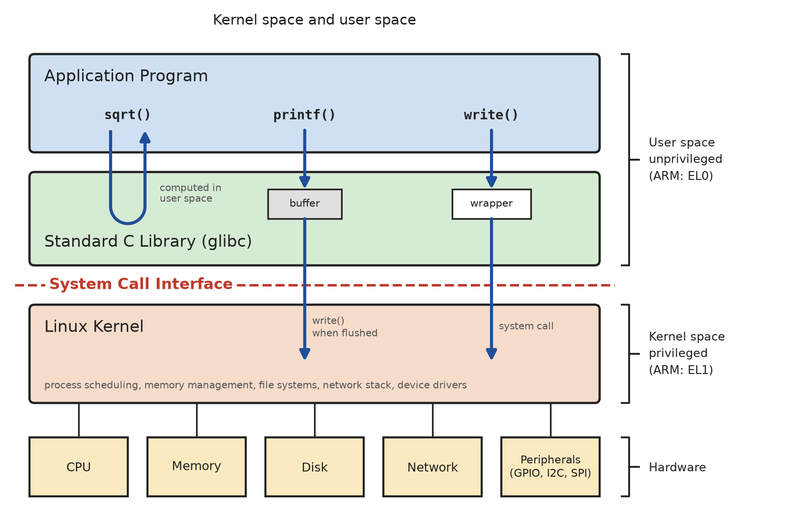

# Linux System Programming 

Linux System Programming refers to writing **software that interacts directly 
with the Linux operating system kernel** and core system libraries, rather 
than sitting high up in an application-level runtime.



_Figure: Kernel space and user space (based on Chris Brown)_

It centers on using the fundamental APIs, primarily standard POSIX and 
Linux-specific **system calls via the C standard library (glibc)**, to 
manage low-level resources. 

Developers write code to control process lifecycles, memory allocation, 
file descriptors, network sockets, signals, and hardware I/O, forming 
the foundational layer that makes user-facing applications and system 
daemons possible.


## User Space vs. Kernel Space

In Linux system architecture, memory and execution privileges are divided into 
two primary zones to ensure stability and security:

* **Kernel Space:** The privileged execution environment where 
    **The Linux Kernel** runs with unrestricted access to underlying hardware 
    (CPU, Memory, Disk, Network). It manages core resources, hardware interrupts, 
    process scheduling, and device drivers.

* **User Space:** The restricted, unprivileged execution environment where 
    **Application Programs** and runtime libraries execute. User applications 
    are isolated from one another and cannot interact with physical hardware directly, 
    preventing errant code from crashing the entire operating system.

This separation is not just a software convention, it is **enforced by the
CPU**:

* **Privilege levels**: The processor runs in different modes. Only the most
  privileged mode may execute certain instructions (e.g. disable interrupts,
  change the page tables) and access hardware registers.

  | Architecture              | User space        | Kernel space       |
  |---------------------------|-------------------|--------------------|
  | ARM (e.g. Raspberry Pi)   | EL0 (Exception Level 0) | EL1           |
  | x86                       | Ring 3            | Ring 0             |

  ARM additionally defines EL2 (hypervisor) and EL3 (secure monitor).

* **Virtual memory**: Every process has its **own virtual address space**.
  The Memory Management Unit (MMU) translates virtual to physical addresses,
  using page tables that only the kernel can modify. A process can therefore
  neither see the memory of other processes nor the memory of the kernel.

* **Protection faults**: If a program tries to access memory that does not
  belong to it, or executes a privileged instruction, the CPU raises an
  exception and switches to the kernel. The kernel then terminates the
  program with a signal (e.g. `SIGSEGV`, "Segmentation fault"), while the
  rest of the system keeps running.

The only way for a program to get something done that it is not allowed to
do itself (reading a file, sending a network packet, starting a process) is
to **ask the kernel** with a **system call**. The system call is the
controlled gate between the two worlds, see [System Calls](../system-calls/README.md).


## Standard Libraries vs. System Calls

* **Standard Libraries (e.g., `glibc`):** High-level interfaces providing 
    utility functions, abstractions, and standardized C APIs. 
    They run entirely in **User Space** and help optimize program execution:

    - **Pure computation (`sqrt()`):** Executed entirely within user space 
        via the math library without needing kernel intervention or context 
        switching.

    - **Higher-level abstraction (`printf()`):** Formats output and manages 
        user-space memory buffers, calling low-level system services only 
        when the buffer needs to be flushed.

* **System Calls (`write()`):** The programmatic gateway between 
    User Space and Kernel Space. Whenever a user program requires hardware 
    access (such as writing bytes to a file descriptor or terminal), it issues 
    a system call. This triggers a context switch from unprivileged mode to 
    privileged kernel mode, allowing the kernel to execute the hardware operation 
    safely on the program's behalf before returning control to user space.

    The function `write()` that we call in C is itself a small **wrapper**
    function in glibc. It puts the system call number and the arguments into
    CPU registers and executes the trap instruction (`svc` on ARM, `syscall`
    on x86-64).

The three paths shown in the figure:

| Function   | Defined in         | Enters the kernel?                     | Cost                     |
|------------|--------------------|----------------------------------------|--------------------------|
| `sqrt()`   | math library (`libm`) | never                               | like any function call   |
| `printf()` | C library (`libc`)  | only when the buffer is flushed (via `write()`) | cheap on average, several calls share one system call |
| `write()`  | system call (wrapper in `libc`) | every call                  | expensive: privilege switch and kernel work for each call |

### Example: Three Paths in One Program

```C
#include <math.h>
#include <stdio.h>
#include <string.h>
#include <unistd.h>

int main(void)
{
    double x = 2.0;

    // 1. Pure computation: runs entirely in user space 
    double root = sqrt(x);

    // 2. Library function: formats the text into a glibc buffer 
    printf("sqrt(%.1f) = %f\n", x, root);

    // 3. System call: hands the bytes directly to the kernel 
    const char *msg = "Hello from write()\n";
    write(STDOUT_FILENO, msg, strlen(msg));

    return 0;
}
```

```bash
$ gcc -Wall -o paths paths.c -lm
```

On the terminal, the output appears in the expected order, because glibc
flushes the `stdout` buffer at every newline when `stdout` is a terminal
(**line buffering**):

```bash
$ ./paths
sqrt(2.0) = 1.414214
Hello from write()
```

When `stdout` is redirected to a file or a pipe, glibc uses **full
buffering**: the `printf()` text stays in the buffer until the program
ends, while `write()` goes to the kernel at once. The order changes:

```bash
$ ./paths > out.txt
$ cat out.txt
Hello from write()
sqrt(2.0) = 1.414214
```

`strace` shows what really reaches the kernel: two `write()` system calls,
but no trace of `sqrt()` or `printf()`, since they never leave user space:

```bash
$ strace -e trace=write ./paths > out.txt
write(1, "Hello from write()\n", 19)    = 19
write(1, "sqrt(2.0) = 1.414214\n", 21)  = 21
+++ exited with 0 +++
```

> Mixing buffered (`printf()`, `fputs()`, ...) and unbuffered (`write()`)
> output on the same file descriptor leads to surprising results. Use one of
> them, or call `fflush(stdout)` before `write()`.


## Standards and Documentation

Linux system programming is based on several layers of standards:

* **ISO C**: The C standard library (`printf()`, `malloc()`, `fopen()`,
  ...). Available on every platform with a C compiler.

* **POSIX** (Portable Operating System Interface, IEEE 1003.1, also known as
  the Single UNIX Specification): Defines the system interface of Unix-like
  operating systems (`open()`, `fork()`, `pthread_create()`, `sigaction()`,
  ...). Code that only uses POSIX functions also runs on other Unix systems
  such as macOS or FreeBSD.

* **Linux-specific interfaces**: Extensions that only exist on Linux, e.g.
  `epoll()`, `inotify`, `signalfd()`, `io_uring`, and most `ioctl()`
  requests for devices.

The C library implements these interfaces on top of the system calls. Linux
supports several C libraries:

| C library   | Typical use                                                          |
|-------------|----------------------------------------------------------------------|
| **glibc**   | Desktop and server distributions, Raspberry Pi OS, Yocto (default)   |
| **musl**    | Small and static binaries, Alpine Linux, OpenWrt, Buildroot (option) |
| **uClibc-ng** | Very small embedded systems, Buildroot (option)                    |

The most important documentation is installed on the system itself, the
**man pages** (`sudo apt install manpages-dev` for sections 2 and 3). They
are organized in sections, which matters when a name exists more than once
(`man 1 write` is a shell command, `man 2 write` the system call):

| Section | Content                                  | Example              |
|---------|------------------------------------------|----------------------|
| 1       | User commands                            | `man 1 printf`       |
| 2       | **System calls**                         | `man 2 open`         |
| 3       | **Library functions**                    | `man 3 printf`       |
| 5       | File formats                             | `man 5 proc`         |
| 7       | Overviews and concepts                   | `man 7 signal`       |
| 8       | System administration commands           | `man 8 ip`           |

Each man page lists the required header files, the return value, the
possible `errno` values, and the standards the function conforms to
(section "STANDARDS" or "CONFORMING TO").


## System Programming on Embedded Linux

On an embedded Linux system, system programming is the way to talk to the
hardware: device drivers in the kernel make the peripherals available as
**files** (see [File Abstraction](../files/README.md)), and the application
uses the same system calls as for regular files:

| Interface | Linux device                  | System calls                                         | Documentation |
|-----------|-------------------------------|------------------------------------------------------|---------------|
| GPIO      | `/dev/gpiochip0`              | `open()`, `ioctl()` (usually via `libgpiod`)          |  |
| I2C       | `/dev/i2c-1`                  | `open()`, `ioctl(I2C_SLAVE / I2C_RDWR)`, `read()`, `write()` | [I2C Protocol](../../raspberry-pi/communication/i2c/i2c-protocol/README.md) |
| SPI       | `/dev/spidev0.0`              | `open()`, `ioctl(SPI_IOC_MESSAGE)`                    | [SPI Protocol](../../raspberry-pi/communication/spi/spi-protocol/README.md) |
| CAN       | network interface `can0`      | `socket(PF_CAN, ...)`, `bind()`, `read()`, `write()`  | [CAN Protocol](../../raspberry-pi/communication/can/can-protocol/README.md) |
| UART      | `/dev/serial0`                | `open()`, `tcsetattr()`, `read()`, `write()`          |  |

Libraries such as `smbus2`, `spidev` or `python-can` in Python are thin
layers on top of exactly these system calls.

Other aspects of system programming that are particularly important on
embedded systems:

* **Processes and signals**: Embedded applications usually run as
  long-lived background services (started by `systemd`) and must terminate
  cleanly on `SIGTERM`.
* **Timing**: Periodic tasks with timers (`timerfd_create()`,
  `clock_nanosleep()`) instead of busy waiting.
* **Event-driven I/O**: Waiting for several devices and sockets at the same
  time with `poll()` or `epoll()`, instead of polling each one in a loop.
* **Limited resources**: Fewer system calls (buffering!), little memory, and
  often a smaller C library (musl, uClibc-ng).


## Tools

| Tool          | Purpose                                                                 |
|---------------|-------------------------------------------------------------------------|
| `man`         | Documentation of system calls (section 2) and library functions (section 3). |
| `strace`      | Traces the **system calls** of a program (arguments, return values, errors). |
| `ltrace`      | Traces the calls of a program to **shared library functions**.          |
| `gdb`         | Debugger: breakpoints, single steps, inspecting variables and memory.    |
| `valgrind`    | Finds memory errors (invalid accesses, memory leaks).                    |
| `/proc/<pid>` | Information about a running process: open files (`fd/`), memory map (`maps`), status. |


## Topics in Linux System Programming

**File I/O & File Systems**

* **Low-Level File Descriptors:** Direct, unbuffered file operations using 
    `open()`, `read()`, `write()`, `close()`, and `lseek()`.

* **I/O Multiplexing & Event Notification:** Scalable synchronous event 
    monitoring across multiple file descriptors via `select()`, `poll()`, 
    and Linux-specific `epoll()`, as well as modern asynchronous I/O with 
    `io_uring`.

* **File System Operations & Metadata:** Managing inodes, hard/symbolic links, 
    file permissions, directory traversal (`opendir()`, `readdir()`), and 
    file monitoring via `inotify`.


**Process Management & Lifecycles**

* **Process Creation & Execution:** Spawning child processes using `fork()`, 
    replacing process images via the `exec()` family, and synchronizing 
    termination statuses with `wait()` / `waitpid()`.

* **Process Attributes & Groups:** Handling process IDs (`PID`, `PPID`), 
    sessions, controlling terminals, and daemonization (running detached 
    background services).


**Memory Management**

* **Virtual Memory Architecture:** Understanding the process address space 
    (stack, heap, data segments, text segment, and memory mapping segment).

* **Direct Page Mapping:** Using `mmap()` and `munmap()` for memory-mapped 
    file I/O, shared memory regions, and allocating anonymous pages directly 
    from the kernel.

* **Heap Manipulation:** Low-level dynamic memory control through `brk()` 
    and `sbrk()`, foundational to standard allocators like `malloc()`.


**Signals & Asynchronous Event Handling**

* **Signal Dispatching & Masks:** Registering handlers with `sigaction()`, 
    blocking/unblocking signals via `sigprocmask()`, and generating 
    software interrupts with `kill()` or `raise()`.

* **Async-Signal Safety:** Writing reentrant, safe signal handlers that 
    avoid non-reentrant standard library calls like `malloc()` or `printf()`.


**Inter-Process Communication (IPC)**

* **Data Streams & Messaging:** Unidirectional anonymous pipes (`pipe()`), 
    named pipes (`mkfifo()`), and POSIX message queues.

* **Shared Memory & Synchronization:** Zero-copy data exchange via POSIX 
    shared memory (`shm_open()`) paired with POSIX semaphores (`sem_init()`, 
    `sem_wait()`).


**POSIX Multithreading (Pthreads)**

* **Thread Lifecycle:** Creating and detaching execution contexts inside 
    the same address space with `pthread_create()`, `pthread_join()`, and 
    `pthread_detach()`.

* **Synchronization Primitives:** Preventing race conditions and 
    coordinating thread states using `pthread_mutex_t`, `pthread_rwlock_t`, 
    and condition variables (`pthread_cond_t`).


**Network Socket Programming**

* **Transport Protocols:** Stream-oriented (TCP) and datagram-oriented (UDP) 
    communication via the Berkeley Sockets API (`socket()`, `bind()`, 
    `listen()`, `accept()`, `connect()`).

* **Local Sockets:** Unix Domain Sockets (`AF_UNIX`) for high-performance, 
    secure local IPC without network stack overhead.


## Contents

* [System Calls](../system-calls/README.md)
* [File Abstraction in Linux](../files/README.md)
* [Permissions](../permissions/README.md)
* [Processes and Pipes](../processes/README.md)
* [Signals](../signals/README.md)
* [Environment and Time](../environment/README.md)


## References

* [YouTube (Chris Brown): Linux System Programming with C](https://youtube.com/playlist?list=PLysdvSvCcUhbrU3HhGhfQVbhjnN9GXCq4&si=Mk3o-qZxlVJln5zb)
    - [Kernel Space and User Space](https://youtu.be/p-vqh0KBtHM?si=6kpqplIUQ2-cJFXV)
    - [System Calls and Error Handling](https://youtu.be/No1vdnYPDjw?si=LlMK5PlCvNReb8PU)
    - [Systems Programming Example in C and Python](https://youtu.be/VHRvR7fiOP8?si=yYMCmanTwnvVMiSH)

* Michael Kerrisk: The Linux Programming Interface, No Starch Press, 2010

* [The Linux man-pages project](https://man7.org/linux/man-pages/)

*Egon Teiniker, 2025-2026, GPL v3.0*
