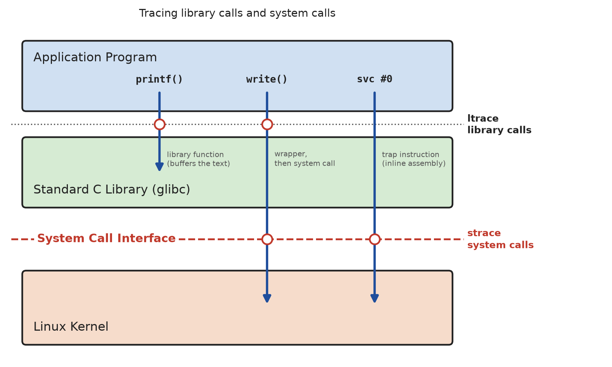

# System Calls

## What is a System Call?

A **system call** is the controlled entry point through which a user-space
program requests a service from the kernel - reading a file, allocating
memory, creating a process, sending a signal, and so on. It is the only
legitimate way to cross from **User Space** to **Kernel Space**: user code
runs unprivileged and has no direct access to hardware or to another
process' memory, so anything that touches a shared or protected resource
has to go through the kernel (see [Introduction](../introduction/README.md)).



* **Mechanism**: Invoking a system call is not a normal function call. The
  process places the syscall number and its arguments into CPU registers
  and executes a special trapping instruction (`syscall` on x86-64, `svc`
  on ARM). This raises the processor's privilege level, transfers control
  to a fixed entry point inside the kernel, and lets the kernel execute the
  requested operation on the program's behalf. Once it is done, the kernel
  returns control (and a result value) to user space and the privilege
  level drops back down. This is a **context switch**, which is
  considerably more expensive than an ordinary function call.

* **glibc wrappers**: Application code almost never issues the trapping
  instruction directly. Instead it calls a small C library wrapper function
  with the same name as the system call (e.g. `open()`, `read()`,
  `fork()`). The wrapper takes care of loading the syscall number and
  arguments into the right registers, trapping into the kernel, and - by
  convention - translating a negative return value into a return value of
  `-1` together with a code stored in the global `errno` variable, which
  `perror()`/`strerror()` can turn into a human-readable message.

* **Kernel vs. library functions**: Not every function in `<stdio.h>` etc.
  is a system call. `printf()`, for example, is a pure user-space library
  function that formats and buffers its output and only issues an
  underlying `write()` system call once the buffer needs to be flushed.
  System calls are the small, well-defined set of operations the kernel
  actually implements (see `man 2 syscalls` for the full list on Linux);
  everything else in the standard library is built on top of them.

* **Categories**: System calls broadly fall into groups such as file and
  IO operations (`open()`, `read()`, `write()`, `close()`, `lseek()`),
  process management (`fork()`, `execve()`, `wait()`, `exit()`), memory
  management (`brk()`, `mmap()`), signal handling (`sigaction()`,
  `kill()`), and inter-process communication (`pipe()`, `socket()`).


## The System Call Mechanism in Detail

A call such as `write(1, buf, 5)` executes the following steps:

1. The application calls the glibc wrapper function `write()` (an ordinary
   function call in user space).
2. The wrapper loads the **system call number** of `write` and the three
   arguments into the registers defined by the architecture's **calling
   convention**.
3. The wrapper executes the **trap instruction**. The CPU switches to the
   privileged mode (ARM: EL0 → EL1) and jumps to the kernel's system call
   entry point.
4. The kernel saves the registers of the process, uses the system call
   number as an index into its **system call table**, and calls the kernel
   function that implements `write` (`ksys_write()`).
5. The kernel returns to user space with the result in a register: the
   number of bytes written, or a **negative error code** (e.g. `-EBADF`).
6. The wrapper converts a negative result into `-1` and sets `errno`, and
   returns to the application.

The calling convention is different for each architecture:

| Architecture                     | Trap instruction | System call number | Arguments 1 - 6             | Result |
|----------------------------------|------------------|--------------------|-----------------------------|--------|
| **ARM64** (Raspberry Pi OS 64-bit) | `svc #0`       | `x8`               | `x0`, `x1`, `x2`, `x3`, `x4`, `x5` | `x0`   |
| **ARM32** (EABI)                 | `svc #0`         | `r7`               | `r0` - `r5`                 | `r0`   |
| **x86-64**                       | `syscall`        | `rax`              | `rdi`, `rsi`, `rdx`, `r10`, `r8`, `r9` | `rax`  |

The **system call numbers** also differ: `write` is number `64` on ARM64,
but number `1` on x86-64; `openat` is `56` on ARM64 and `257` on x86-64.
Programs therefore never use the numbers directly, but the constants from
`<sys/syscall.h>` (`SYS_write`, `SYS_openat`, ...), which are defined for
the architecture the program is compiled for. A compiled program is bound
to the system call numbers of its architecture, which is one reason why an
x86-64 binary cannot run on a Raspberry Pi.

There are three ways to execute a system call from C (see the
[syscall-basics](syscall-basics/README.md) example):

| Way                              | Example                               | `errno` |
|----------------------------------|---------------------------------------|---------|
| glibc wrapper function           | `write(fd, buf, n)`                   | set by the wrapper |
| generic function `syscall()`     | `syscall(SYS_write, fd, buf, n)`      | set by `syscall()` |
| trap instruction (inline assembly) | `svc #0` / `syscall`                | not set: the result is `-errno` |

`syscall()` is useful for new system calls for which glibc has no wrapper
yet. The inline assembly variant is only used inside C libraries and for
learning purposes.

### The vDSO: System Calls without a Trap

Some system calls are called very often, but only read information that
the kernel can provide without a privilege switch, especially the current
time (`clock_gettime()`, `gettimeofday()`, `time()`). For these, the kernel
maps a small shared library into every process, the **vDSO** (virtual
dynamic shared object, visible as `[vdso]` in `/proc/<pid>/maps`). The glibc
functions call the vDSO code in user space, which reads the time from a
memory page shared with the kernel, **without a trap**.

As a consequence, these calls are fast, but **`strace` does not show
them**: a program calling `clock_gettime()` in a loop shows no
`clock_gettime` in its trace, while `ltrace` reports
`vdso->clock_gettime(...)`.


## Error Handling

Every system call can fail, and a program has to **check the return value
of every call**. The convention for the glibc wrappers is:

* On **success**, the return value is a valid result (e.g. a file
  descriptor `>= 0`, the number of bytes, or `0`).
* On **error**, the return value is **`-1`** (for functions returning a
  pointer, such as `mmap()`: a special value like `MAP_FAILED`), and the
  global variable **`errno`** (`<errno.h>`) contains an **error code**.

`errno` is only meaningful **directly after a failed call**: successful
calls do not reset it, and any following library call (even `printf()`)
may change it. Save it in a local variable if it is needed later. In
multithreaded programs, each thread has its own `errno`.

Error messages:

* **`perror("open")`** prints `open: No such file or directory` to `stderr`.
* **`strerror(errno)`** returns the message text, e.g. for `fprintf()`.

```C
int fd = open(path, O_RDONLY);
if (fd == -1)
{
    perror("open");
    exit(EXIT_FAILURE);
}
```

The possible error codes of each system call are listed in its man page
(section "ERRORS"). Some frequent ones:

| `errno`   | Message                                | Typical cause                                 |
|-----------|----------------------------------------|-----------------------------------------------|
| `ENOENT`  | No such file or directory              | wrong path in `open()`                        |
| `EACCES`  | Permission denied                      | missing file permissions, e.g. `/dev/i2c-1` without group `i2c` |
| `EBADF`   | Bad file descriptor                    | file descriptor not open (or already closed)  |
| `EINTR`   | Interrupted system call                | a signal arrived while the call was waiting   |
| `EAGAIN`  | Resource temporarily unavailable       | non-blocking I/O: no data available yet       |
| `EBUSY`   | Device or resource busy                | device is already used by another driver/process |
| `ENXIO`, `EREMOTEIO` | No such device or address / Remote I/O error | I2C target did not answer (NACK) |

### Partial Reads and Writes

`read()` and `write()` may transfer **fewer bytes than requested**. This
is not an error: a pipe or socket may currently hold fewer bytes, a
terminal returns one line at a time, and a write to a pipe or socket may
only partially fit. Robust code therefore loops until all bytes are
transferred.

### Interrupted System Calls (`EINTR`)

A system call that **blocks** (e.g. `read()` from a terminal, a pipe or a
socket) can be interrupted by a **signal**. After the signal handler has
run, the call returns `-1` with `errno == EINTR`, and the program should
simply call it again (alternatively, the `SA_RESTART` flag of
`sigaction()` restarts many calls automatically).

Both cases are handled by a small helper function (from
[errors.c](syscall-basics/errors.c)):

```C
static int write_all(int fd, const void *buf, size_t count)
{
    const char *p = buf;

    while (count > 0)
    {
        ssize_t n = write(fd, p, count);
        if (n == -1)
        {
            if (errno == EINTR)
                continue;       /* interrupted before anything was written: retry */
            return -1;          /* real error: errno is set by write() */
        }
        p += n;
        count -= (size_t) n;
    }
    return 0;
}
```


## Analyzing System Calls with `strace`

[`strace`](https://strace.io/) is a diagnostic tool that intercepts and
records every system call a process makes (using the kernel's `ptrace()`
facility), together with its arguments and return value. It is one of the
most useful tools for understanding what a program is *actually* doing at
the kernel boundary, independent of what its source code claims to do.

* **Basic usage**: Run a program under `strace` and print every system
  call to `stderr`:

  ```bash
  $ strace ./program arg1 arg2
  ```

* **Useful options**:
    - `-o file`: write the trace to `file` instead of `stderr`.
    - `-e trace=openat,read,write,close`: only trace the listed system
      calls; indispensable for filtering out the (often long) sequence of
      calls made by the dynamic linker before `main()` even runs.
    - `-f`: also trace child processes created with `fork()`/`clone()`.
    - `-T`: show the time spent inside each system call.
    - `-c`: instead of a full trace, print a summary table with the
      number of calls, errors, and total time per system call.
    - `-p PID`: attach to and trace an already running process.

* **Reading the output**: Each line has the form
  `syscall(argument, ...) = return_value`, for example:

  ```
  openat(AT_FDCWD, "/etc/hostname", O_RDONLY) = 3
  read(3, "debian13\n", 262144)           = 9
  write(1, "debian13\n", 9)               = 9
  read(3, "", 262144)                     = 0
  close(3)                                = 0
  ```

  This is the trace of `cat /etc/hostname`: the file is opened and gets
  file descriptor `3`, its 9 bytes are `read()` into a buffer and then
  `write()`-ten to file descriptor `1` (stdout), a second `read()` returns
  `0` to signal end-of-file, and the descriptor is `close()`d. The same
  technique applied to the [`text-files`](../files/text-files/README.md)
  example shows exactly which `open()`/`read()`/`write()`/`close()` calls
  the low-level IO functions translate into.

* **Errors** are shown with the symbolic `errno` name and its message,
  which often explains a failing program without looking at the source:

  ```
  openat(AT_FDCWD, "/no/such/file", O_RDONLY) = -1 ENOENT (No such file or directory)
  ```

* **Summary mode** (`strace -c`) is useful for a quick overview of which
  system calls a program relies on most and how much time is spent in
  each of them:

  ```
  % time     seconds  usecs/call     calls    errors syscall
  ------ ----------- ----------- --------- --------- ----------------
   21.52    0.000366          36        10           mmap
   16.28    0.000277          46         6           close
   12.40    0.000211          52         4           openat
    9.23    0.000157          31         5           fstat
    ...
  100.00    0.001701          35        48         1 total
  ```


## Analyzing Library Calls with `ltrace`

`ltrace` works one level higher: it intercepts the calls of a program to
functions in **shared libraries** (e.g. `printf()`, `strlen()`, `malloc()`,
and also the system call wrappers such as `write()`). As shown in the
figure above, the two tools see different calls:

| Call in the program              | `ltrace` | `strace`                             |
|----------------------------------|----------|--------------------------------------|
| `printf()`, `strlen()`, `sqrt()` | yes      | no (only the later `write()` of `printf()`) |
| `write()` (glibc wrapper)        | yes      | yes                                  |
| `syscall(SYS_write, ...)`        | yes      | yes                                  |
| trap instruction (inline assembly) | no     | yes                                  |
| `clock_gettime()` (vDSO)         | yes      | no                                   |

Example ([syscall.c](syscall-basics/syscall.c), output of the program
discarded):

```bash
$ ltrace ./syscall > /dev/null
printf("SYS_write = %d\n", 1)                    = 14
fflush(0x7f1a920295c0)                           = 0
strlen("1. Hello from the write() wrappe"...)    = 34
write(1, "1. Hello from the write() wrappe"..., 34) = 34
strlen("2. Hello from syscall(SYS_write,"...)    = 38
syscall(1, 1, 0x55a5bd46a048, 38)                = 38
strlen("3. Hello from the trap instructi"...)    = 35
strlen("3. Hello from the trap instructi"...)    = 35
strerror(9)                                      = "Bad file descriptor"
printf("raw_write(42, ...) returned %ld "..., -9) = 53
```

This output is from an x86-64 PC, where `SYS_write` is `1`; on a Raspberry
Pi (ARM64) it is `64`. The two `write`s with the trap instruction are
missing, because they don't call a library function. `strace` shows all of
them as `write(...)`.

Useful options: `-e printf+write` (only trace the listed functions),
`-S` (also show system calls), `-c` (summary), `-o file`.

> `ltrace` intercepts calls through the dynamic linker. It does not work for
> statically linked programs, and on some distributions it does not see the
> calls of programs built with certain hardening options. `strace` is
> generally more reliable.


## Example

* [syscall-basics](syscall-basics/README.md): the same `write()` system call
  executed through the wrapper, through `syscall()`, and with the trap
  instruction, plus error handling with `errno`.


## References

* [YouTube (Brian Will): Unix system calls (1/2)](https://youtu.be/xHu7qI1gDPA?si=PpqFVFRK7RlNnBz2)
* [YouTube (Brian Will): Unix system calls (2/2)](https://youtu.be/2DrjQBL5FMU?si=IqChNcv1gZj_8cPd)
* Man pages: `man 2 intro`, `man 2 syscalls` (list of all system calls),
  `man 2 syscall` (calling conventions of all architectures), `man 3 errno`,
  `man 7 vdso`
* Michael Kerrisk: The Linux Programming Interface, No Starch Press, 2010
  (chapter 3: System Programming Concepts)

*Egon Teiniker, 2025-2026, GPL v3.0*  
